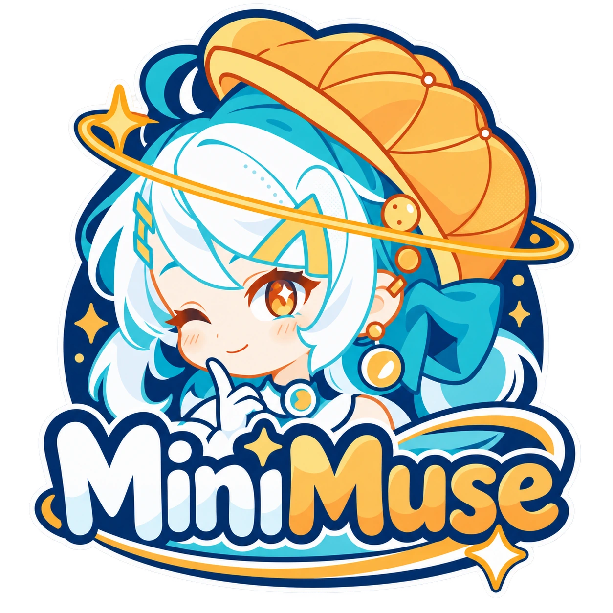
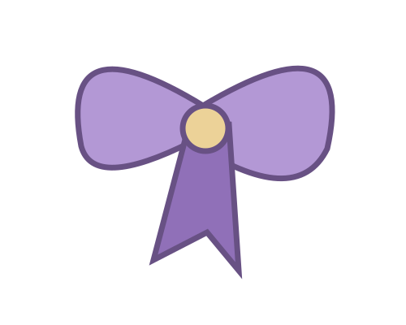
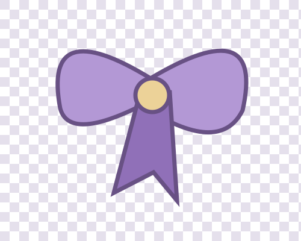
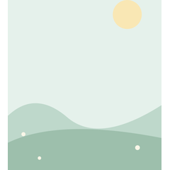

# MiniMuse Tools

[Open MiniMuse Tools](https://minimusetools.com/)

MiniMuse Tools is an independent browser workspace for people who want to repair images, prepare custom assets and arrange visual ideas. It is useful when you already have an image and want to change one part of it, not only when you want to create an entire character composition. Start with an uploaded image, work on a manageable adjustment, and save the result that suits your next step.

## Begin with the image you have

The [Asset Studio](https://minimusetools.com/asset-studio/) brings editing and composition into one workspace. The editing entrance is appropriate for cleaning a background or repairing a small area. The creation entrance provides a different starting point for working with the available assets. Neither requires you to finish a complete character before you can obtain something useful.

A sensible first task is removing a simple background from a single accessory. Keep the original image available, make one change, and compare the result before continuing. This makes it easier to distinguish a successful repair from an accidental loss of detail. An image with a complex background will generally require more careful manual attention than one with a uniform background.

These illustrations show the idea of a background repair. The checkerboard represents transparency in a preview; it is not intended to become part of a transparent exported image. Inspect your own result against more than one background, because a pale edge that disappears on white may still be visible against a darker color.

## Clean edges carefully

Background removal is only the beginning of preparing an asset. Check narrow gaps, fine details and the outer edge of the shape. Color tolerance can affect nearby colors as well as the area you intended to remove. Work gradually when the subject contains colors similar to the background, and use the manual selection and repair controls where an automatic pass is not enough.

The workspace includes ways to select, erase, restore and adjust parts of an image. Use the before-and-after view to judge whether the edit improved the asset. Background cleanup does not reconstruct hidden body parts or reveal pixels that were never present in the source. If clothing or hair covers an area, removing it cannot recover an authentic underlying drawing.

## Arrange independent layers

Separate images can be positioned as layers, allowing you to move, scale, rotate, flip and reorder them. This is useful for testing an accessory with different clothing or comparing a foreground element against several backgrounds. Visibility and opacity adjustments help you inspect a composition without discarding the underlying material.

The examples above are original starter materials from the website, not character parts extracted from the game. Treat each as an editable visual element. A reference outline can help with alignment, but it is a guide rather than part of the finished export. Check the final view rather than assuming every visible workspace aid will be included.

## Choose the right output

A single PNG is useful when you need one cleaned or recolored asset. A complete PNG or JPG is more appropriate when you want a flattened view of the composition. These serve different purposes: a finished picture does not preserve the same independent editing possibilities as a project with separate layers.

An asset ZIP groups materials and accompanying information. It is not an official MiniMuse game package or a ready-made editable character format. When taking individual assets into the game, follow the relevant guide and check their position and scale there. A composition that looks aligned in this workspace may still need adjustment in a different environment.

The .mmstudio project backup is intended for continuing work in the studio. Keep a backup before making a substantial change or clearing browser data. Optional device saving and a deliberately downloaded project backup are not the same thing. Browser storage can be removed, and data saved on one domain is not automatically available on another.

## Work in small, reversible steps

For a first session, choose one accessory and one clear objective. Remove a background, inspect the edge, try a color variation and export the individual asset. Once that process feels familiar, combine two or three layers. A smaller project makes it easier to understand whether a problem comes from the source image, the selection or the arrangement.

When comparing color choices, consider the entire composition rather than a single swatch. An accessory may look very different against light hair, dark clothing or a detailed background. Use the preview to test those relationships, and retain the source material so that an experimental recoloring does not become your only remaining version.

## Privacy, ownership and help

Image processing takes place in the browser. The website also has visitor information about analytics and optional video content, so consult the [Privacy Policy](https://minimusetools.com/privacy/) for the wider site context. Avoid putting sensitive material into shared-device projects, and remember that someone else using the same browser profile may encounter locally retained work.

Only use materials you are entitled to edit and share. A tool that makes an edit possible does not grant permission to redistribute someone else's artwork. Keep useful source and license information with assets that need attribution. The site's guides explain common asset-preparation tasks, while its contact page provides a way to report an unclear instruction or an unexpected result.

[Visit the workspace](https://minimusetools.com/asset-studio/) and begin with one practical improvement to an image you already have.
